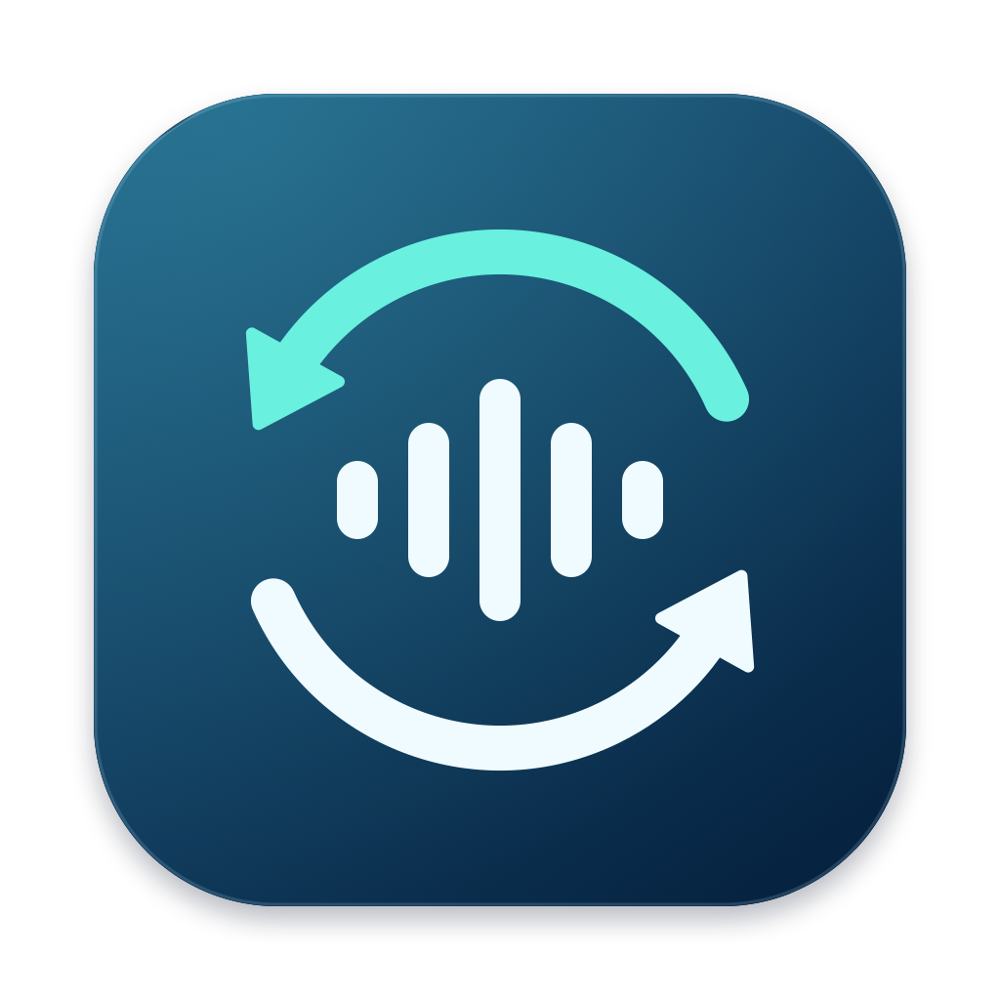

# AudioRateMatch

**根据可确认的播放流格式，自动调整 macOS 输出设备的采样率。**

当前版本：**1.0**。

[下载应用](https://github.com/QiHang-78/AudioRateMatch/releases/latest) · [English](README.en.md) · [兼容范围与原理](docs/ARCHITECTURE.md) · [验证记录](docs/VALIDATION.md) · [发布指南](docs/RELEASING.md)

AudioRateMatch 是使用 Swift、AppKit 和 Core Audio 编写的菜单栏工具。它检测所有音频进程，支持自动跟随或指定一个应用，直接修改系统输出设备的采样率，并回读系统设置和硬件流格式进行验证。

**全应用检测不等于所有应用都能自动匹配原始音源。** 当前识别依赖可用的 Audio Queue 格式及播放事件。无法确认格式、设备不支持或多个播放流冲突时，程序会说明原因并保持当前设置。应用内部已经发生的混音、重采样不能由此还原。

## 功能

- 枚举 Core Audio 音频进程，结合输出状态、播放队列和设备路由确认播放来源。
- 自动跟随所有应用，或指定一个应用作为跟随对象。
- 跟随系统默认输出，或固定使用一个输出设备。
- 检查设备支持的采样率、独占状态，写入后验证系统和硬件流格式。
- 在格式未知、采样率冲突或切换过于频繁时暂缓操作。
- 提供状态窗口、诊断报告、运行日志及命令行工具。

## 系统要求

| 项目 | 要求 / 状态 |
| --- | --- |
| 系统 | 最低构建目标 macOS 14.2；运行验证环境见[验证记录](docs/VALIDATION.md) |
| 架构 | 可构建 arm64、x86_64 或 Universal；Intel 硬件运行尚未验证 |
| 构建 | Apple Command Line Tools 或 Xcode，macOS SDK 14.2+，Swift 5.9+（以 Swift 5 语言模式编译） |
| 依赖 | 系统自带框架和 `/usr/bin/log`，无第三方包 |
| 界面 | 当前为简体中文 |
| 签名 | 构建脚本使用本地临时签名；未进行 Apple 公证 |

最低部署目标仅表示构建设置，不代表已经测试所有 macOS 14.2 及以后的系统版本。格式识别依赖系统日志，系统或播放器更新可能影响兼容性。

## 构建与运行

尚未安装开发工具时，先运行 `xcode-select --install`，完成安装后在项目根目录执行：

```sh
bash test.sh
bash build.sh
open dist/AudioRateMatch.app
```

默认构建当前机器架构。应用位于 `dist/AudioRateMatch.app`，可以复制到“应用程序”。构建和测试本身不会启动音频监听或修改输出设备；运行菜单栏应用后默认启用自动切换。

```sh
# 构建同时包含 Apple Silicon 和 Intel 的应用
bash build.sh --arch universal

# 创建可分发的应用 ZIP 及 SHA-256 校验文件
bash package.sh --arch arm64
```

更多构建、签名与上传方法见[发布指南](docs/RELEASING.md)。从网络下载的未公证构建可能被 macOS 阻止打开；可以自行审查源码后本地构建。项目没有要求关闭系统安全功能。

## 使用

首次运行或版本更新后会显示状态窗口，之后常驻菜单栏 `SR`。

| 菜单项 / 状态 | 行为 |
| --- | --- |
| 自动跟随所有应用 | 选定设备上所有活跃输出的格式都能确认且一致时，允许切换 |
| 跟随应用 | 只根据指定应用判断；该应用未播放或格式未知时保持当前设置 |
| 输出设备 | 跟随系统默认输出，或固定一个设备；不会把其他设备上的声音作为切换依据 |
| 暂停自动切换 | 保持当前设备设置；恢复后继续检测 |
| 重新检测 | 重新加载播放证据并连接日志监听 |
| `SR 96 ✓` | 所跟随播放流、系统设置和硬件输出流均回读为 96 kHz |

同一输出设备在同一时刻使用一套采样率。指定应用模式下，其他应用仍可能由系统重采样；`✓` 也只表示跟随对象与设备一致。采样率匹配不保证 bit-perfect，应用音效、音量和混音仍会影响音频。

切换可能产生短暂静音。请只运行一个采样率控制工具。暂停、退出或所有应用停止输出后，AudioRateMatch 保留设备的最后设置。

## 当前兼容范围

| 播放路径 / 场景 | 当前行为 |
| --- | --- |
| 提供可识别格式与启停事件的 Audio Queue 播放路径 | 可自动跟随；已验证 `afplay`、独立 AVAudioPlayer 示例，以及 QQ 音乐的本地播放场景 |
| 多个已确认的播放流，采样率相同 | 可共同跟随 |
| 多个播放流采样率不同 | 保持设置，提示指定跟随应用 |
| Audio Unit / AVAudioEngine 等未提供可靠源格式的路径 | 显示“格式未确认”，保持设置 |
| 浏览器、游戏、会议软件、DRM 或内部混音路径 | 按实际证据处理；没有普遍兼容保证 |
| 设备不支持目标采样率或被独占 | 显示原因，保持设置 |

如果同一首歌在另一设备显示 96 kHz，本工具仍需要当前 Mac 播放路径提供可信格式，才能判断是否切到 96 kHz。把输出设成 96 kHz 本身不会恢复已经丢失的音源信息。

## 命令行

以下命令均在项目根目录执行。`--status` 与默认的 `--watch` 不修改设备设置；`--watch` 会生成本地诊断日志。

```sh
dist/AudioRateMatch.app/Contents/MacOS/AudioRateMatch --help
dist/AudioRateMatch.app/Contents/MacOS/AudioRateMatch --version
dist/AudioRateMatch.app/Contents/MacOS/AudioRateMatch --status
dist/AudioRateMatch.app/Contents/MacOS/AudioRateMatch --watch --seconds 20
```

`--status` 返回输出设备、音频客户端及其 `selectionKey`。可以使用实际返回的值指定来源和设备：

```sh
dist/AudioRateMatch.app/Contents/MacOS/AudioRateMatch \
  --watch --seconds 20 --source 'SELECTION_KEY' --device 'DEVICE_NAME_OR_UID'
```

将占位值替换为本机结果。`--watch --apply` 会启用真实的自动切换；`--set 96000` 会立即将默认输出设为 96 kHz 并验证，也可配合 `--device`。执行这些写入命令前先退出其他采样率控制工具。

## 数据与隐私

应用不联网，不读取歌曲文件，不捕获或保存音频内容，不安装驱动，也不向其他进程注入代码。它读取 Core Audio 进程信息及经过筛选的系统音频日志。

应用偏好存于 `local.audioratematch` 的 UserDefaults。诊断日志位于 `~/Library/Logs/AudioRateMatch/AudioRateMatch.log`，超过约 2 MB 时会在下一次 GUI 启动时保留一份旧日志。内容可能包含应用或设备名称、来源标识、采样率、时间及错误信息。`--status` 还会显示 PID、可执行文件路径和设备 UID；提交 Issue 前请删去个人路径和设备标识。

## 开发

```text
Sources/              应用、音频硬件访问、日志监听与匹配策略
Tests/                使用合成事件的解析和策略测试
Resources/Info.plist   应用信息模板
Resources/AppIcon.*    macOS 应用图标及 PNG 预览
Artwork/              原创图标的可编辑绘制代码
scripts/              图标生成脚本
VERSION               发布版本号
build.sh              构建并签名应用
test.sh               运行不访问音频硬件的测试
package.sh            构建应用 ZIP 与校验文件
docs/                 原理、验证记录、发布指南
.github/              CI 与 Issue / PR 模板
```

测试涵盖进程隔离、PID 重用、预加载、播放交叠、设备路由、应用选择和切换节流。GitHub Actions 配置会在 Apple Silicon 和 Intel macOS runner 上执行测试及原生构建；CI 不连接真实 DAC，不验证实际播放兼容性。

图标由项目中的 AppKit 绘制代码生成，使用深蓝底、同步环与音频波形。修改 `Artwork/GenerateIcon.swift` 后运行 `bash scripts/generate-icons.sh`，即可重新生成 16–1024 像素的 macOS 图标和 PNG 预览；普通构建直接使用已提交的图标资源。图标与代码一同采用 MIT 许可证。

欢迎提交兼容性报告与改进，见 [CONTRIBUTING.md](CONTRIBUTING.md)。

## 许可证

[MIT](LICENSE)，Copyright © 2026 AudioRateMatch contributors。
