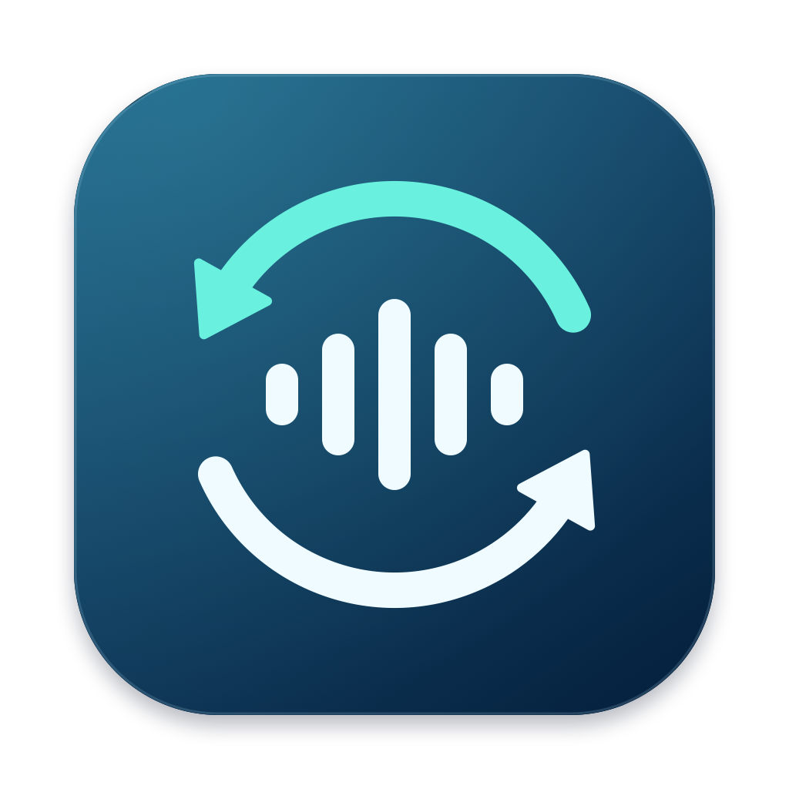

# AudioRateMatch

**根据可确认的播放流格式，自动调整 macOS 输出设备的采样率。**

当前版本：**1.1.0**。

[下载应用](https://github.com/QiHang-78/AudioRateMatch/releases/latest) · [English](README.en.md) · [兼容范围与原理](docs/ARCHITECTURE.md) · [验证记录](docs/VALIDATION.md) · [发布指南](docs/RELEASING.md)

AudioRateMatch 是使用 Swift、AppKit 和 Core Audio 编写的菜单栏工具。它检测所有音频进程，支持自动跟随或指定一个应用，直接修改系统输出设备的采样率，并回读系统设置和硬件流格式进行验证。

**全应用检测不等于所有应用都能自动匹配原始音源。** 当前识别依赖可用的 Audio Queue 格式及播放事件。无法确认格式、设备不支持或多个播放流冲突时，程序会说明原因并保持当前设置。应用内部已经发生的混音、重采样不能由此还原。

## 功能

- 默认开启“播放前匹配”：用 1 秒内存缓冲拦住需要换采样率的新歌，暂停播放器，等待 DAC 格式和运行时钟稳定，再回到歌头播放。
- 同采样率换歌保持现有音频路径；不满足提前切换条件时保持设备设置。
- 枚举 Core Audio 音频进程，结合输出状态、播放队列和设备路由确认播放来源。
- 自动跟随所有应用，或指定一个应用作为跟随对象。
- 跟随系统默认输出，或固定使用一个输出设备。
- 检查设备支持的采样率、独占状态，写入后验证系统和硬件流格式。
- 在格式未知、采样率冲突或切换过于频繁时暂缓操作。
- 提供状态窗口、诊断报告、运行日志及命令行工具。

## 系统要求

| 项目 | 要求 / 状态 |
| --- | --- |
| 系统 | 最低构建目标 macOS 14.2；运行验证环境见[验证记录](docs/VALIDATION.md) |
| 架构 | 可构建 arm64、x86_64 或 Universal；Intel 硬件运行尚未验证 |
| 构建 | Apple Command Line Tools 或 Xcode，macOS SDK 14.2+，Swift 5.9+（以 Swift 5 语言模式编译） |
| 依赖 | 系统框架、`/usr/bin/log`、`/usr/bin/perl`；MIT / BSD 组件源码随仓库提供，无需 Homebrew |
| 界面 | 当前为简体中文 |
| 签名 | 构建脚本使用本地临时签名；未进行 Apple 公证 |

最低部署目标仅表示构建设置，不代表已经测试所有 macOS 14.2 及以后的系统版本。格式识别依赖系统日志，系统或播放器更新可能影响兼容性。

## 构建与运行

尚未安装开发工具时，先运行 `xcode-select --install`，完成安装后在项目根目录执行：

```sh
bash test.sh
bash build.sh
open dist/AudioRateMatch.app
```

默认构建当前机器架构。应用位于 `dist/AudioRateMatch.app`，可以复制到“应用程序”。构建和测试本身不会启动音频监听或修改输出设备；运行菜单栏应用后默认启用自动切换。

```sh
# 构建同时包含 Apple Silicon 和 Intel 的应用
bash build.sh --arch universal

# 创建可分发的应用 ZIP 及 SHA-256 校验文件
bash package.sh --arch arm64
```

更多构建、签名与上传方法见[发布指南](docs/RELEASING.md)。从网络下载的未公证构建可能被 macOS 阻止打开；可以自行审查源码后本地构建。项目没有要求关闭系统安全功能。

## 使用

首次运行或版本更新后会显示状态窗口，之后常驻菜单栏的波形图标。悬停可查看采样率与状态，点击展开完整菜单。

如果找不到图标，从“应用程序”重新打开 AudioRateMatch 会重新创建菜单栏入口并显示状态窗口。也可以点击窗口中的“恢复菜单栏图标”，或通过“更多操作”使用同一套菜单。

在提供“允许在菜单栏显示”设置的 macOS 版本中，确认 AudioRateMatch 的开关已开启。如果安装了 YoungBar 等菜单栏管理器，还需在管理器中将 AudioRateMatch 设为“显示”；系统开关开启时，第三方隐藏规则仍可能使图标不可见。恢复按钮不会修改这些外部规则。菜单栏自动隐藏或空间不足也会影响显示。

| 菜单项 / 状态 | 行为 |
| --- | --- |
| 自动跟随所有应用 | 选定设备上所有活跃输出的格式都能确认且一致时，允许切换 |
| 跟随应用 | 只根据指定应用判断；该应用未播放或格式未知时保持当前设置 |
| 输出设备 | 跟随系统默认输出，或固定一个设备；不会把其他设备上的声音作为切换依据 |
| 播放前匹配（缓冲 1 秒） | 默认开启；选定设备的音频增加约 1 秒延迟，适合音乐。关闭后使用原先的播放中切换方式 |
| 暂停自动切换 | 保持当前设备设置；恢复后继续检测 |
| 重新检测 | 重新加载播放证据并连接日志监听 |
| 已匹配 · 系统与硬件流回读一致 | 所跟随播放流、系统设置和硬件输出流均回读为显示的采样率 |

同一输出设备在同一时刻使用一套采样率。指定应用模式下，其他应用仍可能由系统重采样；“已匹配”也只表示跟随对象与设备一致。采样率匹配不保证 bit-perfect，应用音效、音量和混音仍会影响音频。

播放前匹配把 DAC 的等待时间移到新歌响起之前，换采样率时仍会有换曲等待，不能保证无缝衔接。视频、游戏、会议会受到约 1 秒输出延迟影响，可关闭此选项。

提前切换需要同时确认新歌、及时的 Audio Queue 起播事件、可暂停并跳转的系统播放器控制，以及没有其他进程正在向选定设备输出。初次接管正在播放的歌曲、歌曲中途继续播放、未知格式或不支持控制的应用会保持设备采样率，避免中途打断。详见[播放前匹配](docs/PREPLAY.md)。

请只运行一个采样率控制工具。暂停、退出或所有应用停止输出后，AudioRateMatch 保留设备的最后设置。

## 当前兼容范围

| 播放路径 / 场景 | 当前行为 |
| --- | --- |
| 提供可识别格式与启停事件的 Audio Queue 播放路径 | 可检测格式；直接切换模式已验证 `afplay`、独立 AVAudioPlayer 示例和 QQ 音乐本地播放；播放前模式另需播放器控制，见[验证记录](docs/VALIDATION.md) |
| 多个已确认的播放流，采样率相同 | 可共同识别；播放前模式在多进程输出时暂缓跨采样率切换 |
| 多个播放流采样率不同 | 保持设置，显示冲突；直接切换模式可指定跟随应用 |
| Audio Unit / AVAudioEngine 等未提供可靠源格式的路径 | 显示“格式未确认”，保持设置 |
| 浏览器、游戏、会议软件、DRM 或内部混音路径 | 按实际证据处理；没有普遍兼容保证 |
| 设备不支持目标采样率或被独占 | 显示原因，保持设置 |

如果同一首歌在另一设备显示 96 kHz，本工具仍需要当前 Mac 播放路径提供可信格式，才能判断是否切到 96 kHz。把输出设成 96 kHz 本身不会恢复已经丢失的音源信息。

## 命令行

以下命令均在项目根目录执行。`--status` 与默认的 `--watch` 不修改设备设置；`--watch` 会生成本地诊断日志。

```sh
dist/AudioRateMatch.app/Contents/MacOS/AudioRateMatch --help
dist/AudioRateMatch.app/Contents/MacOS/AudioRateMatch --version
dist/AudioRateMatch.app/Contents/MacOS/AudioRateMatch --status
dist/AudioRateMatch.app/Contents/MacOS/AudioRateMatch --watch --seconds 20
```

`--status` 返回输出设备、音频客户端及其 `selectionKey`。可以使用实际返回的值指定来源和设备：

```sh
dist/AudioRateMatch.app/Contents/MacOS/AudioRateMatch \
  --watch --seconds 20 --source 'SELECTION_KEY' --device 'DEVICE_NAME_OR_UID'
```

将占位值替换为本机结果。`--watch --apply --preplay` 可测试播放前匹配；不带 `--preplay` 的 `--watch --apply` 使用播放中直接切换；`--set 96000` 会立即将默认输出设为 96 kHz 并验证，也可配合 `--device`。执行这些写入命令前先退出其他采样率控制工具。

## 数据与隐私

应用不联网，不读取歌曲文件，不安装驱动，也不向播放器注入代码。播放前匹配通过 Core Audio Tap 捕获选定设备的系统音频，在内存中延迟并重新输出；不将音频保存到文件或上传。macOS 可能要求授予“系统音频录制”权限，拒绝或捕获失败时恢复直通并保持设备设置。关闭此模式后不捕获音频。

它还读取 Core Audio 进程信息、筛选后的系统音频日志，以及系统正在播放信息（歌曲标识仅用于防止误控制）。MediaRemote 播放控制使用随应用构建的 BSD 组件，并依赖 Apple 私有接口；系统更新可能影响兼容性。

应用偏好存于 `local.audioratematch` 的 UserDefaults。诊断日志位于 `~/Library/Logs/AudioRateMatch/AudioRateMatch.log`，超过约 2 MB 时会在下一次 GUI 启动时保留一份旧日志。内容可能包含应用或设备名称、来源标识、采样率、时间及错误信息。`--status` 还会显示 PID、可执行文件路径和设备 UID；提交 Issue 前请删去个人路径和设备标识。

## 开发

```text
Sources/              应用、音频硬件访问、日志监听与匹配策略
Tests/                播放证据、提前切换策略及逐帧 PCM 测试
Native/               实时音频缓冲（C11 原子操作）
Vendor/               随源码构建的 MIT / BSD 组件及许可证
Resources/Info.plist   应用信息模板
Resources/AppIcon.*    macOS 应用图标及 PNG 预览
Artwork/              原创图标的可编辑绘制代码
scripts/              图标生成及播放器控制组件构建
VERSION               发布版本号
build.sh              构建并签名应用
test.sh               运行不访问音频硬件的测试
package.sh            构建应用 ZIP 与校验文件
docs/                 原理、验证记录、发布指南
.github/              CI 与 Issue / PR 模板
```

测试涵盖进程隔离、PID 重用、预加载、播放交叠、设备路由、应用选择和切换节流。GitHub Actions 配置会在 Apple Silicon 和 Intel macOS runner 上执行测试及原生构建；CI 不连接真实 DAC，不验证实际播放兼容性。

图标由项目中的 AppKit 绘制代码生成，使用深蓝底、同步环与音频波形。修改 `Artwork/GenerateIcon.swift` 后运行 `bash scripts/generate-icons.sh`，即可重新生成 16–1024 像素的 macOS 图标和 PNG 预览；普通构建直接使用已提交的图标资源。图标与代码一同采用 MIT 许可证。

欢迎提交兼容性报告与改进，见 [CONTRIBUTING.md](CONTRIBUTING.md)。

## 许可证

[MIT](LICENSE)，Copyright © 2026 AudioRateMatch contributors。第三方代码分别保留 [CoreAudioTapKit MIT 许可证](Vendor/CoreAudioTapKit/LICENSE) 与 [mediaremote-adapter BSD-3-Clause 许可证](Vendor/mediaremote-adapter/LICENSE)。
